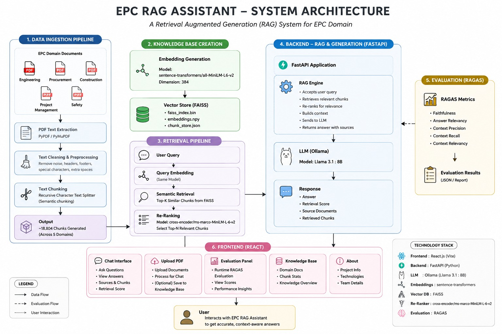
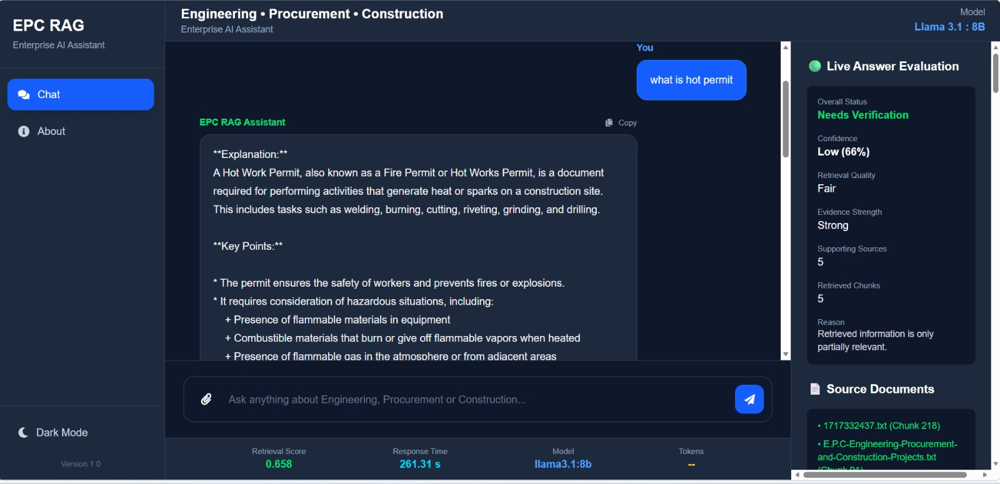
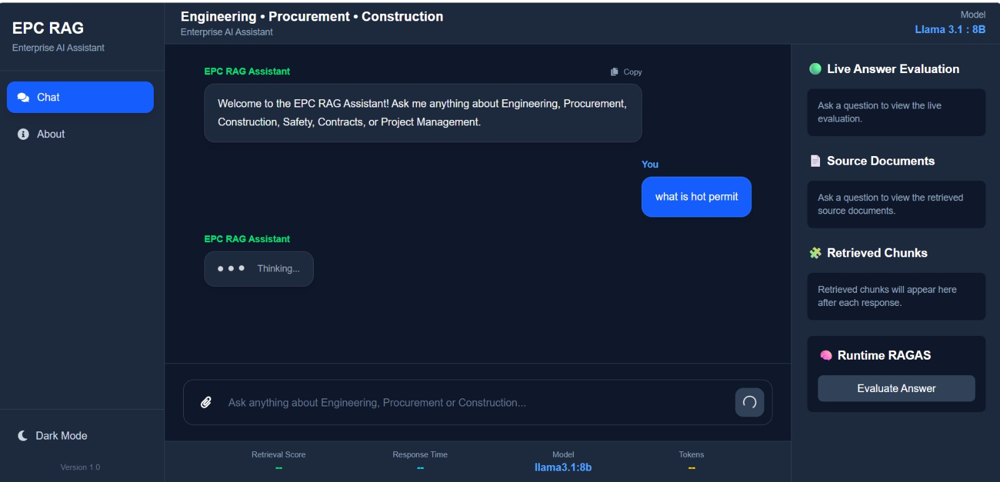
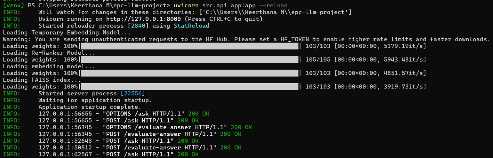

# EPC RAG Assistant – Domain-Specific AI Assistant for Engineering, Procurement and Construction (EPC)

<p align="center">


</p>

---

## Project Overview

The **EPC RAG Assistant** is a domain-specific AI assistant designed for the **Engineering, Procurement, and Construction (EPC)** industry. It leverages **Retrieval-Augmented Generation (RAG)** to provide accurate, context-aware, and evidence-backed responses from EPC documentation.

Unlike a traditional chatbot that relies solely on a Large Language Model (LLM), this system retrieves relevant information from EPC documents, reranks the retrieved content, and generates responses grounded in the source material. This significantly reduces hallucinations while improving response reliability.

This project was developed during an **AI Internship at PI Labs** and is currently being extended as part of an ongoing **research paper** focused on domain-specific Retrieval-Augmented Generation systems.

---

# Objectives

- Build an intelligent AI assistant for EPC documents.
- Improve information retrieval using semantic search.
- Reduce hallucinations through Retrieval-Augmented Generation.
- Generate evidence-backed responses using retrieved context.
- Assist engineers in quickly accessing technical knowledge.
- Demonstrate a practical AI solution for the EPC domain.

---

# Key Features

- PDF document ingestion
- Intelligent text chunking
- Semantic embeddings using Sentence Transformers
- FAISS vector database for semantic retrieval
- Cross-Encoder for re-ranking
- Ollama-powered answer generation
- Multi-turn conversation memory
- Evidence-backed responses with retrieved sources
- Retrieval score visualization
- OCR support for scanned PDFs
- Table extraction
- Image extraction
- Metadata extraction
- FastAPI backend
- React-based user interface

---

# System Architecture

```text
                        User
                          │
                          ▼
                 React Frontend
                          │
                          ▼
                 FastAPI Backend
                          │
                          ▼
                     RAG Engine
                          │
          ┌───────────────┴────────────────┐
          ▼                                ▼
   Conversation Memory              Query Embedding
                                            │
                                            ▼
                                 FAISS Vector Database
                                            │
                                            ▼
                                  Top-k Document Retrieval
                                            │
                                            ▼
                                 Cross Encoder Re-ranking
                                            │
                                            ▼
                                  Relevant EPC Context
                                            │
                                            ▼
                                  Ollama Large Language Model
                                            │
                                            ▼
                              Evidence-backed Final Response
```

---

# Technology Stack

### Programming Languages

- Python
- JavaScript

### Frontend

- React
- Vite
- HTML
- CSS
- Axios

### Backend

- FastAPI
- Uvicorn

### Artificial Intelligence

- Retrieval-Augmented Generation (RAG)
- Ollama
- Sentence Transformers
- Hugging Face Transformers
- Cross Encoder Re-ranking

### Vector Database

- FAISS

### Document Processing

- PyMuPDF
- OCR
- Table Extraction
- Image Extraction
- Metadata Extraction

### Tools

- Git
- GitHub
- VS Code
- Postman

---

# Data Preparation

To build the EPC knowledge base, follow these steps:

### 1. Place EPC PDF documents inside

```text
data/raw/
```

---

### 2. Extract text from PDF documents

```bash
python -m src.ingestion.pdf_loader
```

---

### 3. Generate document chunks

```bash
python -m src.preprocessing.text_chunker
```

---

### 4. Create the chunk store

```bash
python -m src.embeddings.create_chunk_store
```

---

### 5. Generate embeddings and build the FAISS vector database

```bash
python -m src.embeddings.create_embeddings
```

---

### 6. Start the Backend

```bash
python -m uvicorn src.api.app:app --reload
```

---

### 7. Start the Frontend

```bash
cd frontend

npm run dev
```

The EPC RAG Assistant is now ready to answer engineering, procurement, and construction-related questions.

# Application Screenshots

## System Architecture

The following architecture illustrates the complete workflow of the EPC RAG Assistant, from EPC document ingestion to response generation using Retrieval-Augmented Generation (RAG).

<p align="center">

</p>

---

## Chat Interface

The React-based interface allows users to ask Engineering, Procurement, and Construction (EPC) related questions using natural language. The assistant retrieves relevant document chunks before generating an evidence-grounded response.

<p align="center">

</p>

---

## AI Response with Retrieved Sources

Each generated response is accompanied by supporting source documents, retrieved chunks, and retrieval information, enabling users to verify the generated answer.

<p align="center">

</p>

---

## Backend Execution

The FastAPI backend initializes the embedding model, FAISS vector database, and Cross-Encoder re-ranker before serving user queries.

<p align="center">

</p>

---

# Project Demonstration

A demonstration video showcasing the complete workflow of the EPC RAG Assistant is included in this repository.

 **Demo Video:** `docs/Video Project.mp4`

---

# System Evaluation

The EPC RAG Assistant was evaluated through live interaction using domain-specific Engineering, Procurement, and Construction queries.

The evaluation focused on:

- Response relevance
- Retrieval quality
- Supporting source documents
- Retrieved chunk quality
- Retrieval score analysis
- Conversation continuity
- Evidence-backed answer generation

The system provides retrieval scores together with supporting documents, allowing users to validate responses using the retrieved EPC knowledge.

> **Future Scope:** Integration of the **RAGAS** evaluation framework is planned for future versions of the project. Automated metrics such as **Faithfulness**, **Answer Relevancy**, **Context Precision**, **Context Recall**, and **Context Relevancy** will be incorporated to provide comprehensive evaluation of generated responses.

---

# Research Contribution

This project is currently being extended into a research paper focusing on **domain-specific Retrieval-Augmented Generation (RAG)** for Engineering, Procurement, and Construction (EPC).

The research explores how semantic retrieval, intelligent document preprocessing, vector databases, and evidence-grounded response generation can improve knowledge access within highly specialized engineering domains.

Current research directions include:

- Improving retrieval accuracy
- Optimizing chunking strategies
- Enhancing evidence-backed response generation
- Expanding multimodal document understanding
- Automated RAG evaluation
- Scalable AI assistants for EPC organizations

---

# Future Enhancements

The EPC RAG Assistant provides a strong foundation for AI-powered document intelligence. Future work will focus on improving retrieval quality, scalability, usability, and evaluation.

Planned enhancements include:

- Automated evaluation using **RAGAS**
- Hybrid Retrieval (Dense + BM25)
- Knowledge Graph integration
- Multi-document reasoning
- Citation-aware response generation
- Cloud deployment
- Docker containerization
- User authentication
- Multi-user knowledge base management
- Advanced OCR and multimodal document understanding
- Analytics dashboard for system monitoring

---

# Project Highlights

- Domain-Specific AI Assistant for EPC
- Retrieval-Augmented Generation (RAG)
- Semantic Search using FAISS
- Ollama-powered Large Language Model
- FastAPI Backend
- React Frontend
- Cross-Encoder Re-ranking
- Intelligent Document Processing
- Evidence-backed Responses
- Live Retrieval Evaluation
- Research Paper in Progress

---

# Contributors

**Developed during the AI Internship at PI Labs**

- **Keerthana M**
- **Keerthi B Patil**
- **Lal Bee**

---

# Acknowledgements

We sincerely thank **PI Labs** for providing the opportunity, mentorship, and resources to work on this project during our AI Internship.

We also acknowledge the open-source community and the developers behind the technologies used in this project:

- FastAPI
- React
- Ollama
- FAISS
- Hugging Face
- Sentence Transformers
- PyMuPDF

Their contributions made the development of this project possible.

---

# License

This project is licensed under the **MIT License**.

See the **LICENSE** file for more information.

---

# Support

If you found this project useful, consider giving this repository a on GitHub.

Your support encourages future development and improvements.

---

<p align="center">

##  Built with Passion for AI, Engineering & Innovation

### EPC RAG Assistant Team

</p>
